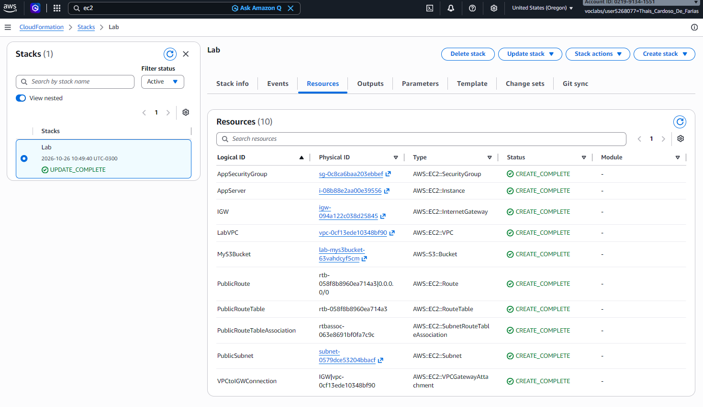
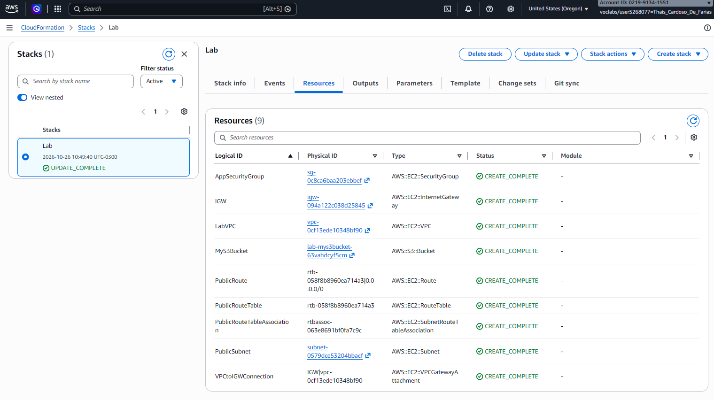
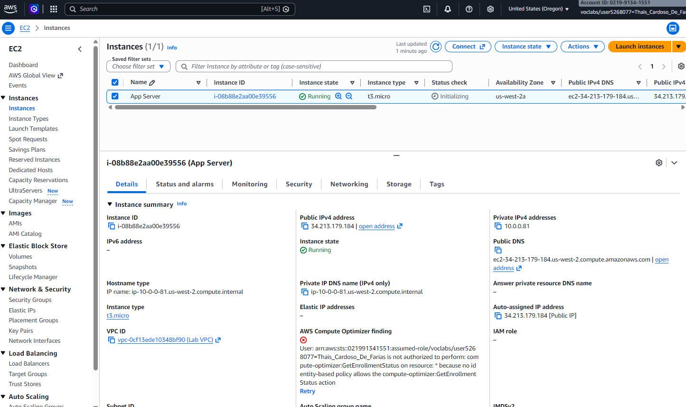

# 🚀 Automação de Infraestrutura na AWS com CloudFormation

Este repositório documenta um laboratório prático focado em **Infraestrutura como Código (IaC)** utilizando o **AWS CloudFormation**. O objetivo foi criar, atualizar e gerenciar recursos de forma automatizada e consistente através de templates em **YAML**.

---

## 🛠️ Arquitetura e Recursos Provisionados

O template do CloudFormation utilizado neste projeto gerencia os seguintes componentes na AWS:
1. **Rede (VPC):** Criação de uma Virtual Private Cloud isolada com blocos CIDR definidos.
2. **Segurança:** Configuração de um Security Group padrão para controle de tráfego (`AppSecurityGroup`).
3. **Armazenamento:** Adição incremental de um **Amazon S3 Bucket** via atualização de stack.
4. **Computação:** Provisionamento dinâmico de uma instância **Amazon EC2 (`t3.micro`)** utilizando o *AWS Systems Manager Parameter Store* para buscar a versão mais recente da AMI do Amazon Linux 2.

---

## 📸 Evidências do Laboratório (Screenshots)

Abaixo estão as comprovações do sucesso na implantação e gerenciamento da infraestrutura:

### 1. Stack Criada e Atualizada com Sucesso
Confirmação do status `UPDATE_COMPLETE` no console do AWS CloudFormation, indicando que todas as alterações de código foram aplicadas corretamente.

### 2. Recursos Gerenciados pela Stack
Aba de recursos listando todos os elementos automatizados pelo CloudFormation (VPC, Subnet, Internet Gateway, S3 Bucket e a Instância EC2).

### 3. Instância EC2 em Execução
Visualização do servidor virtual (`App Server`) rodando na nuvem AWS, criado de forma automatizada através do template IaC.

---

## 🧠 Aprendizados e Habilidades Desenvolvidas
* **Infraestrutura como Código (IaC):** Compreensão de como declarar estados de infraestrutura usando arquivos de configuração YAML.
* **Gestão de Mudanças (Change Sets):** Aprendizado sobre como atualizar recursos existentes sem precisar destruir o ambiente.
* **Uso de Parâmetros e Referências (`!Ref`):** Conexão dinâmica entre diferentes recursos da AWS (como vincular a instância EC2 à sub-rede e ao grupo de segurança corretos).
* **Boas Práticas de Cloud:** Importância da limpeza de recursos (*stack deletion*) para otimização de custos e segurança em ambientes de teste.

---
*Desenvolvido como parte de estudos práticos em computação em nuvem e DevOps.*
